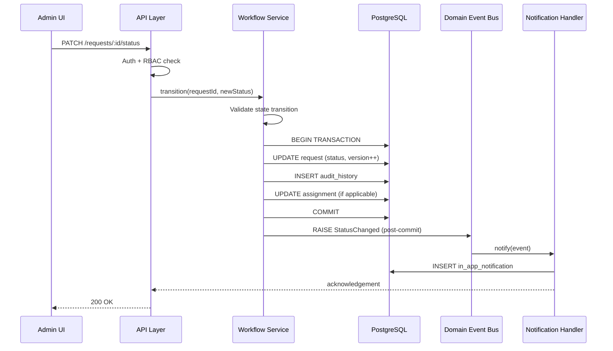

# Runtime View - Status Transition to Notification

## Diagram

## Key Properties

- **Atomicity:** All writes in single transaction (A2 Task 2) - status, audit, assignment
- **Post-commit event:** Notification never fires for rolled-back changes
- **In-process:** No network boundary (A2 Task 3)
- **Optimistic concurrency:** Version column on request row detects lost updates
- **Append-only audit:** Audit history records cannot be updated or deleted through normal application code

## ASRs Satisfied

- ASR-02 (Real-Time Status Transparency)
- ASR-03 (RBAC & Audit Accountability)
- ASR-08 (Audit Retention)

## Related Decision Records

- **ADR-PERSIST-01:** [Transactional Status Transition](./Architecture_Decision_Record/ADR-PERSIST-01-transactional-transitions.md)
- **ADR-PERSIST-01 supporting analysis:** [Decision matrix, theoretical foundation, references, verification plan](./Architecture_Decision_Record/ADR-PERSIST-01-supporting-analysis.md)
- **ADR-INT-01:** [Notification Integration](./Architecture_Decision_Record/ADR-INT-01-notification-integration.md)

## Related Requirements

- FR-04 — Role-based admin dashboard for routing, updating, closing tickets
- FR-05 — Notification on status change
- FR-06 — Citizens can track report status
- NFR-01 — Offline-to-online sync performance

## Verification Evidence

- TC-BE-04 — Status transition succeeds end-to-end (integration)
- TC-BE-05 — Deliberate failure mid-transaction → no state change persisted (negative)
- TC-BE-06 — Version mismatch → 409 Conflict (negative)
- TC-BE-07 — Post-commit event fires only after successful commit (unit + integration)
- TC-BE-08 — Notification NOT persisted when transaction fails (negative)
- TC-BE-09 — Concurrent updates — one wins, other gets 409 (concurrency)

## Link

- PED architecture: [07-architecture.md](../Project_Engineering_Document/07-architecture.md)
- PED persistence: [09-data-persistence.md](../Project_Engineering_Document/09-data-persistence.md)
- RTM: [Requirements_Traceability_Matrix/README.md](../Requirements_Traceability_Matrix/README.md)
